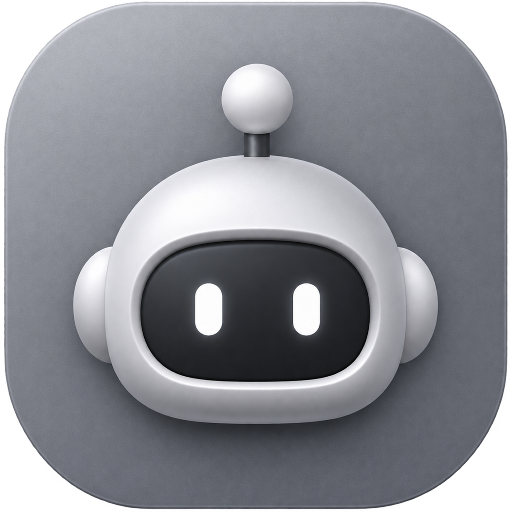
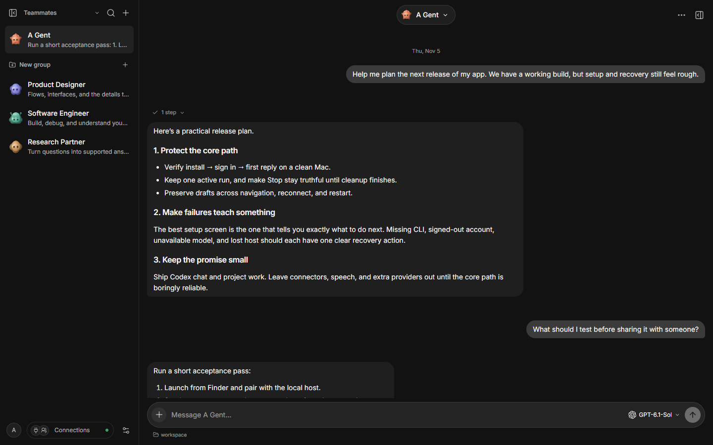
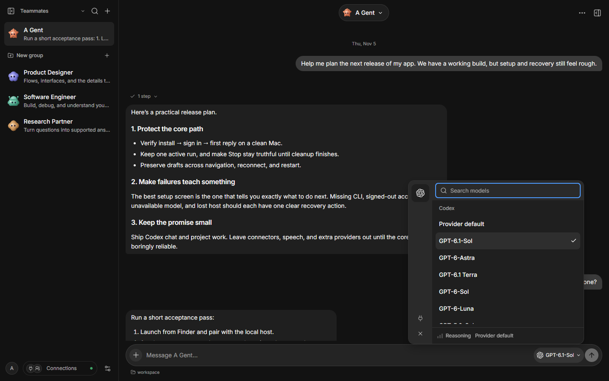

<p align="center">
  
</p>

<h1 align="center">A Gent</h1>

<p align="center">
  <strong>Your private AI workspace for thinking, writing, and building with Codex.</strong><br>
  Chat naturally, work inside your own project folders, and keep your data on your Mac.
</p>

<p align="center">
  
  
  
  
  
</p>

---

A Gent is a desktop home for your AI work. It brings the Codex CLI into a calm, focused interface: streamed conversations, saved drafts, project folders, sandboxed work, and clear approvals — without sending your workspace to a hosted A Gent service.

## Download

| Platform | Get A Gent | Status |
| --- | --- | --- |
| **macOS 13+ Apple silicon** | [Download the macOS build](https://github.com/danialshirali16/a-gent/releases/latest) | **Preview build pending** |
| Windows 10/11 x64 | [Windows build](https://github.com/danialshirali16/a-gent/releases/latest) | Paused |
| Android | [Android companion](https://github.com/danialshirali16/a-gent/releases/latest) | Paused |
| Linux | — | Not supported |

> **A public build has not been published yet.** These links open the project’s Releases page. The first macOS preview is still being built and tested. Windows and Android are not part of this release. Personal preview builds are unsigned, so macOS may ask for a one-time confirmation in **System Settings → Privacy & Security**.

### Install on macOS

1. Open the DMG and drag **A Gent** into **Applications**.
2. Launch A Gent from Finder. The app starts its own local host and pairs itself automatically.
3. Install and sign in to the [Codex CLI](https://github.com/openai/codex) on the same Mac. A Gent uses that existing account and never copies your credentials.
4. In A Gent, open **Connections → Check connection**, choose a model, and start a conversation.

If the Codex CLI is missing or signed out, A Gent tells you what to do next instead of leaving you at a dead end.

## A quieter way to work with AI

| | |
| --- | --- |
| **Conversations that stay put** | Streamed replies, saved history, and unsent drafts that survive switching chats, reconnecting, and relaunching. |
| **Your own project folders** | Pick a folder with the native Mac dialog. **Chat** reads and explains. **Work** edits inside that folder under Codex’s sandbox. |
| **Approvals you can trust** | A Gent shows the actual command or file change before it happens. Decline it, accept it, or stop the run. Nothing is pretended. |
| **Honest Stop** | Press Stop and A Gent stays in “Stopping…” until the model and tools have actually finished. Your next message starts only after cleanup. |
| **One task at a time** | This preview runs one task per host, so you always know what is using your machine. |
| **Local by design** | Your host runs on `127.0.0.1`. Conversations, drafts, and project data stay on your Mac. There is no A Gent cloud account. |
| **Codex, with your settings** | Model choice, provider-default reasoning, and your external Codex sign-in. A Gent does not rewrite `~/.codex/config.toml`. |
| **A clean, native feel** | Keyboard-friendly controls, reduced-motion support, light and dark themes, and a focused reading layout. |

## Screenshots

<p align="center">
  
  <br>
  <sub>Conversations, saved history, and a composer that stays out of the way.</sub>
</p>

<p align="center">
  
  <br>
  <sub>Choose a Codex model without leaving the conversation.</sub>
</p>

## A first five-minute tour

1. **Ask something real.** “Help me plan the next release of my app.” Watch the answer stream in.
2. **Pick a model.** Open the model pill above the composer. The choice is remembered for that chat.
3. **Try a project.** Choose **Project folder**, then switch to **Work** when you want changes inside that folder.
4. **Approve something.** When Codex asks for access, read the request. Try declining once; the action should not happen.
5. **Stop a long answer.** Press Stop. The button changes to “Stopping…” and the chat stays reserved until cleanup finishes.
6. **Quit and come back.** Your conversation and any unsent draft should still be there.

## What this preview includes

- Codex chat with streamed text, Stop, and continuation
- Model selection with provider-default reasoning
- Native project-folder selection
- Read-only **Chat** and sandboxed **Work**
- Command, file, and access approvals; supported native questions
- Persisted conversations and device-local drafts
- Automatic desktop pairing with the bundled local host
- Local data, one-generation backup, and sanitized export/import
- Keyboard navigation, focus return, reduced motion, and axe-checked screens

## What is not included yet

This is a deliberate, small preview:

- Windows and Android apps
- OpenCode, Claude, Gemini, Ollama, or custom model endpoints
- Connected Apps / MCP management
- Custom reasoning controls
- Agent skill management
- Speech-to-text
- Multiple simultaneous runs
- Public signing, notarization, or automatic updates

Those paths are paused, not silently offered. Existing saved data is preserved while they are unavailable.

## Your data

A Gent keeps its workspace on your Mac:

```text
~/Library/Application Support/A Gent/workspace
```

That folder contains your conversations, settings, backups, and the private pairing token. Unsent drafts live in the app’s local storage so they survive a normal relaunch; they are not part of a workspace export.

- **Quit with ⌘Q** before copying a backup.
- Copy the whole workspace folder for a local backup.
- Portable export leaves out credentials, runtime thread IDs, and provider bindings.
- Your Codex account remains managed by the Codex CLI. A Gent never copies your account tokens.

## Requirements

- macOS 13 or later on Apple silicon
- The Codex CLI installed and signed in with your own account
- A network connection for model replies

A Gent does not require an A Gent account, a subscription, or a cloud workspace.

## Questions

****<br>
No. You need the Codex CLI installed and signed in, but you do not need to build or configure A Gent.

****<br>
Your host runs locally. Codex receives the conversation and project context you ask it to work on, under your Codex account and the sandbox you selected.

****<br>
A Gent waits for the model and any running tools to finish, so a stopped run cannot keep working in the background.

****<br>
Not in this preview. Remote-device setup is deferred.

****<br>
[Open an issue](https://github.com/danialshirali16/a-gent/issues) with what you expected, what happened, and your macOS version.

---

<p align="center">
  <sub>Built for a personal macOS preview. Looking for the technical documentation? <a href="docs/README.md">Start here</a>.</sub>
</p>
