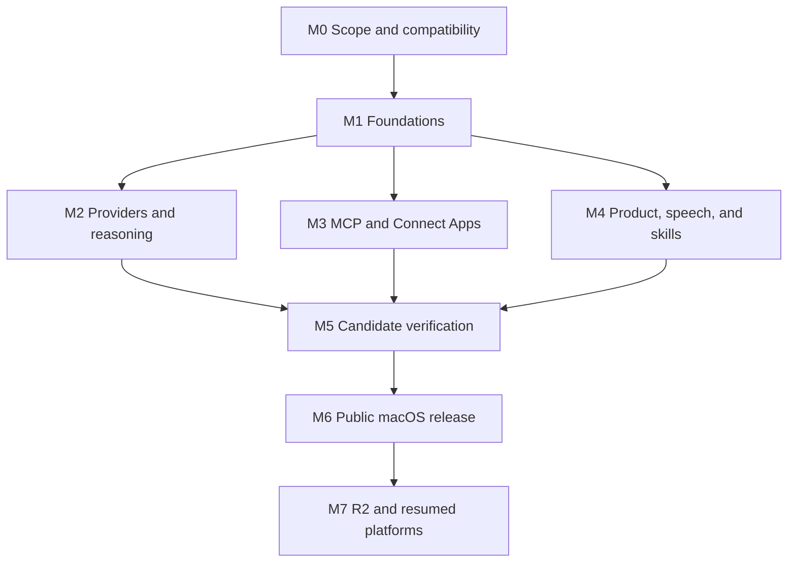

# A Gent completion and release roadmap

Updated: 2026-11-05. Status: proposed execution plan grounded in the current source. Branch: `main`. Active implementation scope remains **macOS first**; Windows and Android are paused until explicitly resumed.

[Documentation index](README.md) · [Integration review](integration-review.md) · [Task board index](roadmaps/README.md) · [Current state](current-state-review.md) · [Validation](validation.md)

## Objective and release boundaries

Finish the promised provider and app workflows, complete the core local workspace, and release a tested, signed A Gent package. The installed Reason UI remains a visual/workflow reference; A Gent keeps its own implementation, branding, data, and integrations.

**R1** is the proposed first public macOS release. It includes complete supported provider journeys, a usable MCP/Connect Apps lifecycle for the selected agent runtimes, model-specific reasoning controls, adding/managing Agent skills, ElevenLabs Speech-to-Text, text chat/project workflows, one-time scheduling, recovery, accessibility, and distribution evidence. It does not close the original Windows/Android goal or later product tasks.

**R2** retains broader product completion: multiple connection profiles, provider-independent MCP execution for HTTP models, binary attachments, recurring schedules, branching, richer files, usage, and selected team workflows. **Paused** tasks preserve Windows and Android delivery. **Optional** native/browser control and later signed updates need their own accepted scope. Speech-to-Text is required; spoken replies, voice calls, and always-listening behavior need separate scope. Reason's private cloud and billing remain outside scope.

ElevenLabs as the initial STT provider, model-specific effort, skill management, and benchmarking before development are user requirements. The other release boundaries and choices are now recorded through FND-001; a feature promoted into R1 brings its tests, dependencies, and release gate with it, and a deferred feature remains visibly open.

Every section follows **benchmark → design decisions → development → verification**. The [benchmark board](roadmaps/benchmarking.md) defines 25 scope prerequisites; [the process and record template](benchmarks/README.md) define evidence and acceptance. Every delivery task has a BEN dependency. Existing source or upstream documentation alone does not mark a benchmark complete.

**M0 status (2026-11-05): accepted.** [BEN-001](benchmarks/BEN-001-foundations.md), [FND-001](release-contract.md), and [FND-002](runtime-baselines.md) are Done; D-01–D-11 and the initial [QA-001 support matrix](support-matrix.md) are recorded. **M1 is complete:** FND-003–FND-012 are Done; the foundation set (BEN-001, FND-001–FND-012) is accepted. **M2 is in progress (Codex/OpenCode only):** BEN-002–BEN-004 and BEN-021/BEN-022 are accepted; shared readiness/catalog/model-ID, adapter capability, Codex reasoning/dynamic picker, session/Keychain credentials/disconnect, inference testing, endpoint policy, chat/agent selection scope, and core model-specific reasoning controls and verification are implemented (PVD-001–016; EFF-001–007/EFF-011), and real Codex/OpenCode turns passed. Remaining M2 work is PVD-017/CDX/OPC/EFF-008–012. **M3 is in progress:** BEN-008–BEN-010 are accepted and MCP/Connect Apps tasks are being implemented. Cloud/OpenAI-compatible, Ollama, and Gemini/Antigravity are deferred by the D-02 amendment. This acceptance covers foundations/compatibility, the shared provider lifecycle, and MCP/HIL scope, not product/speech/skills/release implementation.

## Source-based assessment

The [integration review](integration-review.md) records exact source locations and upstream references. This planning pass inspected code and test definitions; it did not perform new account logins, model requests, MCP connections, live OAuth checks, test-suite runs, package rebuilds, or publication.

- Provider adapters exist, but setup/authentication, readiness, persistence, editing/removal, model capabilities, and negative-path verification are incomplete.
- Connect Apps currently refreshes an inventory of MCP servers already configured in Codex. It does not provide an end-to-end add/authenticate/scope/use/disable/remove workflow.
- Existing Codex/OpenCode runtimes may execute externally configured tools. HTTP model adapters currently provide chat without their own MCP tool loop.
- MCP elicitation is declined and tool questions receive empty answers. Supported user input needs a real interaction flow.
- The initial **18-component UI pass** is complete. Provider/MCP product completion and release readiness are separate milestones.
- Seven modelOptions findings and three earlier backend findings remain open. Earlier green suites/packages do not certify the latest source.
- Codex model capability metadata is now preserved and the picker renders per-model enum options/defaults, but OpenCode mapping, migration, cross-surface controls, and EFF-012 verification remain. There is still no implemented STT adapter or Skills manager.

## Workstream map

| Board | Tasks | Readiness today |
| --- | ---: | --- |
| [Foundations](#foundation-tasks) | 12 | BEN-001 and FND-001–012 accepted; M1 complete |
| [Provider integration completion](roadmaps/providers.md) | 44 | R1 Codex/OpenCode only; HTTP/Ollama/Gemini deferred; shared lifecycle slice implemented |
| [MCP and Connect Apps completion](roadmaps/connect-apps.md) | 40 | BEN-008–010 accepted; lifecycle implementation next |
| [Model-specific reasoning controls](roadmaps/reasoning-effort.md) | 12 | Fixed options/defaults need capability-driven replacement |
| [Agent skills](roadmaps/skills.md) | 20 | Creation/import/management/runtime flow missing |
| [ElevenLabs Speech-to-Text](roadmaps/speech-to-text.md) | 18 | Required; not implemented |
| [Core product and UI completion](roadmaps/product.md) | 22 | Working foundations; gaps remain |
| [Quality, packaging, and release](roadmaps/quality-release.md) | 24 | Historical tests/packages; new candidate required |
| [Paused platforms and later product completion](roadmaps/platforms-next.md) | 20 | Paused / later scope |
| [Benchmark prerequisites](roadmaps/benchmarking.md) | 25 | BEN-001–004/BEN-008–010/BEN-021–022 accepted; 13 R1 comparisons remain; BEN-005/006/007 deferred |

**237 tracked acceptance tasks:** **191 R1, 28 R2**, 16 paused-platform, and 2 optional-scope tasks. The 2026-11-05 D-02 amendment moved 17 provider/benchmark tasks (HTTP/Ollama/Gemini plus BEN-005/006/007) from R1 to R2 “distant future.” As of 2026-11-05, BEN-001–004/BEN-008–010/BEN-021–022, FND-001–FND-012, PVD-001–016, MCP-001–005, HIL-001/HIL-002, CDX-004, OPC-002, and EFF-001–007/EFF-011 are Done. R1 provider focus is Codex/OpenCode only.

## Decisions to record

**Recorded 2026-11-05:** D-01–D-11 are accepted in [the release contract](release-contract.md). The table below is retained as the trace from the original recommendation to the accepted record.

| Decision | Recommended starting position | Record needed before dependent work |
| --- | --- | --- |
| D-01 — release scope | First public release on macOS; preserve Windows/Android as paused delivery phases | Release audience, features, version, platform/architecture/minimum OS, and supported launch matrix |
| D-02 — provider promise | Codex/OpenCode as agent runtimes; Ollama/custom/Cloud/Gemini-compatible endpoints according to actual adapter capabilities | Required auth modes and real-service acceptance per entry; decide whether Antigravity means Gemini API compatibility or a native runtime integration |
| D-03 — MCP execution ownership | Use supported Codex/OpenCode runtimes behind A Gent adapters for R1; a shared host connection service owns A Gent configuration/scope | Runtime/config/auth ownership, supported transports, external config adoption; if all HTTP models must use MCP at launch, promote FUT-001 into R1 |
| D-04 — secrets and authority | macOS Keychain plus an explicit session-only mode; public readiness contains no secrets; connection/tool mutations follow host roles | Credential storage/retention, remote-device rights, imported versus managed entries, tool grants and approval policy |
| D-05 — launch apps | A small verified catalog plus custom local/remote setup; exercise local, anonymous remote, and OAuth scenarios | Named supported connectors/publishers, required account registrations/scopes, setup ownership, and test environments |
| D-06 — compatibility and distribution | Pin/probe supported runtime schemas; use supported production paths; public macOS release must pass signing/notarization checks | Minimum runtime versions, feature fallback policy, signing ownership, distribution/support channel, update/rollback strategy |
| D-07 — behavior and feature scope | Make global/agent/chat model defaults explicit; complete text workflows plus the requested STT and skills journeys; retain larger content/scheduling features as R2 | Selection/session rules, retry/history behavior, attachment limits, schedule semantics, and any R2 features promoted to R1 |
| D-08 — Speech-to-Text | ElevenLabs is the initial provider; review/edit transcript before explicit Send through the selected Agent | Benchmark-selected realtime/batch transport, current model/API, microphone/host authority, credential storage, languages, retention, measured quality/cost, and native-package permissions |
| D-09 — reasoning controls | Only the selected model's verified options/default; unknown metadata uses provider default with no guessed parameter | Capability sources/version/freshness, provider-native enum/budget/boolean mapping, selection migration, and cross-surface behavior |
| D-10 — Agent skills | Add/create/import/manage skills and enable/use them within actual runtime capabilities and existing permissions | Supported format/sources, managed versus external files, per-Agent/project/global scope, native versus HTTP instruction-only behavior, updates/removal/export and rollback |
| D-11 — benchmark gate | Every delivery scope benchmarks at least two relevant peers/reference implementations before development | Scope-matched dated evidence, adopted decisions/tradeoffs, acceptance/test mapping, actual DRI/reviewer, and recheck triggers; see the benchmark process |

Technical choices can be resolved during their tasks, but changes to a product promise or release boundary must be recorded here and propagated to the boards. No calendar date is promised before tasks are sized and actual owners/capacity are assigned.

## Milestones and dependencies

| Milestone | Purpose | Exit evidence |
| --- | --- | --- |
| M0 — scope and compatibility | Benchmark foundations, agree product promises, runtime support, and owners | **Accepted 2026-11-05:** [BEN-001](benchmarks/BEN-001-foundations.md), [FND-001](release-contract.md), and [FND-002](runtime-baselines.md) accepted; D-01–D-11 and the [QA-001 support matrix](support-matrix.md) recorded |
| M1 — reliable foundations | Stable schemas, authority, secret/config interfaces, sessions, cancellation, persistence, and pending interactions | **Accepted 2026-11-05:** FND-003 through FND-012 accepted; priority backend reproductions have an owned correction path (QA-004) |
| M2 — providers and reasoning | Complete every advertised R1 provider and model-specific settings | **In progress:** BEN-002 shared lifecycle accepted 2026-11-05; remaining R1 provider tasks, PVD-017, and EFF-012 still required |
| M3 — MCP and Connect Apps | Complete connection/auth/access/use/removal rather than only inventory | **In progress:** BEN-008–BEN-010 accepted 2026-11-05; MCP-022/APP-012/HIL-006 still required |
| M4 — product, speech, and skills | Close R1 core/UI gaps and deliver requested speech/skills journeys | R1 product tasks, STT-018, and SKL-020 accepted; the seven catalog findings closed through their owning provider tasks |
| M5 — release quality | Verify the actual candidate and all advertised journeys | QA-012 accepted with fresh regression, failure/recovery, real-integration, performance, and packaged evidence |
| M6 — first public release | Sign, notarize, pilot, and publish the approved candidate | REL-012 accepted; exact tag/commit, artifacts, hashes, release notes, support and rollback recorded |
| M7 — continued completion | Deliver accepted R2 and reactivated platform work | Each later task and native-platform release gate accepted; unfinished optional work remains explicit |

QA and packaging preparation start alongside implementation after their own benchmarks; milestone arrows show acceptance gates. Task-level dependencies govern readiness. Every milestone exit requires accepted comparisons for its scopes. MCP work depends on shared contracts/secrets/authority, not on waiting for every unrelated provider to finish.

## Foundation tasks

Development gate: **BEN-001** is accepted for this scope (2026-11-05). **All foundation tasks FND-001–FND-012 are Done.** Provider/MCP/product/speech/skills work now moves to its own benchmarks and delivery boards.

| ID | Target | Priority | Status | Owner | Depends on | Task and acceptance |
| --- | --- | --- | --- | --- | --- | --- |
| FND-001 | R1 | P0 | Done | Product | BEN-001 | **Confirm the release contract and open decisions.** Accepted 2026-11-05: D-01–D-11, R1 boundaries, launch support matrix, exclusions, and owner acceptance are recorded in [the release contract](release-contract.md); no unfinished feature is relabeled complete. |
| FND-002 | R1 | P0 | Done | Integrations | BEN-001, FND-001 | **Capture runtime versions and capability/schema baselines.** Accepted 2026-11-05: Node/Electron/Codex/OpenCode versions, generated Codex schema, OpenCode OpenAPI, fixtures, and unsupported-method fallbacks are recorded in [the runtime baseline](runtime-baselines.md) and verified by `scripts/runtime-baseline.mjs`. |
| FND-003 | R1 | P0 | Done | Host | BEN-001, FND-001 | **Version the durable data and integration schemas.** Accepted 2026-11-05: workspace v2 adds provider/profile bindings, scoped app/skill records, chat effort, and non-secret speech settings; v1 migration, backup recovery, export stripping, and merge rules pass. Record: [durable workspace schema](data-schema.md). |
| FND-004 | R1 | P0 | Done | Host + Product | BEN-001, FND-001 | **Define host/device authority and tool access boundaries.** Accepted 2026-11-05: administrator, host desktop, and remote-device roles are defined; provider credentials, endpoints, defaults, speech, import/export, and device management are host-authority operations enforced by API tests. Future app/skill/STT boundaries are explicit. Record: [authority model](authority-model.md). |
| FND-005 | R1 | P0 | Done | Host | BEN-001, FND-004 | **Bind event streams to authenticated devices.** Accepted 2026-11-05: SSE clients carry the authenticated device ID; rotation/revocation closes affected streams and invalidates old tokens; unrelated device streams remain connected. Record: [authority model](authority-model.md#verification). |
| FND-006 | R1 | P0 | Done | Host | BEN-001, FND-003 | **Define durable run and interruption lifecycle.** Accepted 2026-11-05: reservation holds until provider cleanup; Codex waits for turn/exit; OpenCode escalates SIGTERM→SIGKILL and settles only after child exit; shutdown persists active messages as interrupted. Record: [run lifecycle](run-lifecycle.md). |
| FND-007 | R1 | P0 | Done | Host | BEN-001, FND-003 | **Isolate provider session bindings.** Accepted 2026-11-05: runtime reuse requires matching provider/kind/profile/workspace/model and a non-empty thread; mismatches and legacy thread IDs clear the binding and rebuild deliberately. Record: [durable workspace schema](data-schema.md#runtime-session-reuse-fnd-007). |
| FND-008 | R1 | P0 | Done | Host | BEN-001, FND-003 | **Verify atomic persistence and recovery contracts.** Accepted 2026-11-05: writes are snapshotted and serialized, fsynced temp files replace atomically, one backup generation is retained, failed imports roll back, and lock/restart/corrupt-primary recovery pass. Record: [persistence](persistence.md). |
| FND-009 | R1 | P0 | Done | Host | BEN-001, FND-003, FND-004, FND-006 | **Add correlated pending interaction state.** Accepted 2026-11-05: interaction records carry host/run/conversation/provider/thread identity; approvals persist and resolve, unsupported questions/forms are recorded cancelled, pending records expire on restart, and hosts are isolated. Record: [interactions](interactions.md). |
| FND-010 | R1 | P0 | Done | Host | BEN-001, FND-006 | **Define timeout budgets and cancellation primitives.** Accepted 2026-11-05: shared startup/catalog/auth/tool/session/interrupt/stream/interaction/shutdown/termination/heartbeat budgets and budgetSignal/combineBudget/withBudget helpers are applied across adapters and covered by tests. Record: [timeouts](timeouts.md). |
| FND-011 | R1 | P1 | Done | Host + QA | BEN-001, FND-003 | **Standardize diagnostics and error events.** Accepted 2026-11-05: request IDs on HTTP/SSE errors, run/provider correlation, structured error envelope, redaction of tokens/keys/credentials/provider text, and focused tests. Record: [diagnostics](diagnostics.md). |
| FND-012 | R1 | P0 | Done | Host | BEN-001, FND-003, FND-004 | **Define shared config/secret storage interfaces.** Accepted 2026-11-05: owner-scoped ConfigStore with versioning/migration/atomic rollback, SecretStore with memory and encrypted-file backends, export exclusion, and tests. Record: [config and secrets](config-secrets.md). |

## Recommended execution order

1. **Done (2026-11-05):** BEN-001, FND-001, and FND-002; D-01–D-11, versions/fixtures, and the launch support matrix are recorded.
2. **Done (2026-11-05):** FND-003–FND-012; schema, authority, SSE binding, run lifecycle, session binding, persistence, interactions, timeouts, diagnostics, and config/secret foundations. Start the scoped provider/MCP/product benchmarks next.
3. **Done for the R1 Codex/OpenCode scope:** BEN-002–BEN-004 and BEN-021/BEN-022, plus shared readiness/catalog/model-ID. Next: credentials, provider journeys, model-specific effort, and selection semantics. BEN-005/006/007 are deferred.
4. Benchmark and deliver one vertical slice: Codex setup → selected model/valid effort → one app connection → authentication/access → real tool use → interruption/restart → disable/remove. Include a question/form case.
5. Complete the skills comparisons, then create/import → enable for an Agent → actual use → edit/update → disable/remove; finish the OpenCode journey after BEN-004.
6. Benchmark ElevenLabs API, recording UX, and evaluation methods; connect the key → speak → edit transcript → Send through the selected Agent. Verify cleanup, quality/cost, and signed-Mac microphone behavior.
7. Finish R1 core, Connect Apps, and accessibility after their comparisons. Repeat adversarial catalog, effort, app, speech, and skill fixtures.
8. Complete QA/release benchmarks, then candidate verification, signing, clean-machine install/upgrade, and pilot checks; publish only the reviewed artifact set.
9. Benchmark each accepted R2 scope and resumed Windows/Android phase before development and follow its own release gate.

## How to run the project

### Task states and ownership

Use **To do → Ready → In progress → Review → Validated → Done**. Use **Blocked** only with a concrete dependency/external requirement and the next action. Owner cells currently name recommended roles; assign an actual DRI before moving a task to Ready.

- **To do:** acceptance package is defined; existing code may be partial.
- **Ready:** the task's BEN dependency has an accepted record explicitly covering its scope, product/design decisions are recorded, other dependencies have accepted evidence, and the actual owner/reviewer are clear.
- **In progress:** one owned task/vertical slice is being implemented. Keep work in progress small rather than opening every integration simultaneously.
- **Review:** code/docs and the concrete behavior are ready for review.
- **Validated:** the task's required checks ran against the identified source/artifact, including meaningful negative paths.
- **Done:** acceptance is met, evidence is linked in validation, affected docs/boards are updated, and the reviewer accepts closure.

P0 blocks trustworthy integration or release correctness/security. P1 completes advertised workflows and required release quality. P2 is later scope. Severity is not an estimate. Moving an R1 task out of the release requires an explicit scope decision, a recorded reason, and consistent UI/docs.

### Per-task delivery process

1. Read the owning board and integration evidence. Benchmark the task's scope under its BEN prerequisite; compare at least two relevant peers/reference implementations and record dated/versioned observations, failures, and limitations in [the benchmark records](benchmarks/README.md).
2. Accept the benchmark and adopted design decisions before Ready or development. Reproduce the current gap, map schema/API/UI/runtime changes, migrations, compatibility, authorization/data effects and acceptance tests, and preserve unrelated working-tree changes. Split large scopes into linked tasks/benchmarks when needed.
3. Implement one usable flow with failure, cancellation, and restart behavior. Define capabilities in the host and enforce them at the API boundary; recheck benchmark coverage if requirements or runtime behavior change.
4. Run checks appropriate to the change: meaningful unit/contract/integration tests, keyboard/accessibility/responsive checks for UI, real-service smoke evidence for advertised integrations, package verification for release changes.
5. Record date, task ID, commit/tree or artifact identity, commands, fixtures versus real account coverage, results, screenshots/logs, and unverified cases in [validation](validation.md).
6. Update status only in the owning task board; update current-state and component/UI notes when behavior changes. Reopen a task if later evidence contradicts its acceptance.

A UI control, successful catalog fetch, fixture pass, or old screenshot is not sufficient to close an integration. Documentation-only tasks use documentation checks; they do not imply new runtime validation.

### Tracking and progress

Maintain task status in the owning board, decisions in this master and [the release contract](release-contract.md), current behavior in current-state-review, and executed evidence in validation. Report completed versus total **R1 acceptance tasks**, the active vertical slice, remaining P0/P1 items, and concrete blockers. Do not use speculative overall completion percentages. Current position: **54 of 191 R1 tasks Done** (BEN-001–004/BEN-008–010/BEN-021–022, FND-001–FND-012, PVD-001–PVD-016, MCP-001–005, HIL-001/HIL-002, CDX-004, OPC-002, EFF-001–EFF-007/EFF-011); M3 benchmarks accepted, scoped runtime inventory, app-record CRUD, question/form answers, and HIL routing implemented. **M1 is complete, M2 is in progress for Codex/OpenCode.** Next: MCP lifecycle/config adoption and Connect Apps onboarding, then M3 acceptance.

Use issue tracking later if useful, retaining these IDs and acceptance criteria. Creating this roadmap does not create external issues, run production changes, or authorize publication.

## Release acceptance

Before publication, every pre-publication R1 task must be Done, including QA-012; REL-012 is the final publication task. Confirm:

- Advertised provider setup/use/Stop/restart/edit/removal journeys pass against supported real integrations.
- Supported MCP app add/authenticate/scope/use/restart/disable/remove journeys pass; user questions and elicitation do not receive fabricated answers.
- Model catalog findings and priority backend findings have regression evidence.
- Every R1 scope has accepted benchmark evidence and adopted decisions linked to its delivery tasks.
- The selected model exposes and sends only verified reasoning settings; switching/defaults/migrations and unsupported/unknown behavior pass EFF-012.
- Skills create/import/manage/scope/use/update/disable/remove/export and supported-runtime journeys pass SKL-020 with existing permission boundaries enforced.
- ElevenLabs key setup, deliberate speech capture, editable transcript, explicit Send through the selected Agent, measured accuracy/latency/cost, and signed-Mac microphone recovery pass STT-018.
- Core data, schedules, drafts, attachments, streaming, offline/crash recovery, keyboard, VoiceOver, motion preferences, and actual zoom checks pass for the agreed scope.
- Fresh typecheck/backend/smoke/visual/axe/E2E evidence and performance budgets apply to the candidate.
- Packaged resources match source; secrets/private data/dev fixtures are excluded; notices and release documentation are reviewed.
- Signing/notarization, clean-Mac install/upgrade, protected release permissions, pilot triage, checksums, support, and rollback are complete.
- The owner approves the concrete candidate and publication destination before REL-012 publishes it.

R1 shipping does not close R2, paused, or optional tasks. Original cross-platform completion requires WIN-006 and AND-008 after those workstreams resume.

## Evidence and document ownership

- [Integration review](integration-review.md): source-based current gaps and checked upstream references.
- [Release contract](release-contract.md): FND-001 decisions D-01–D-11, R1 boundaries, owners, and support summary.
- [Runtime baseline](runtime-baselines.md): FND-002 versions, generated interfaces, fixtures, and unsupported-method fallbacks.
- [Durable workspace schema](data-schema.md): FND-003 v2 fields, migration/rollback/import behavior, and tests.
- [Authority model](authority-model.md): FND-004 roles, API boundary, future app/skill/STT constraints, and tests.
- [Run lifecycle](run-lifecycle.md): FND-006 states, Stop/termination rules, shutdown recovery, and tests.
- [Persistence](persistence.md): FND-008 atomic writes, backup/recovery, import transaction, locks, and tests.
- [Interactions](interactions.md): FND-009 correlated approvals/questions/forms, restart expiry, host isolation, and tests.
- [Timeouts](timeouts.md): FND-010 shared budgets, cancellation primitives, adapter mapping, and tests.
- [Diagnostics](diagnostics.md): FND-011 request/run/provider correlation, redaction, error envelope, and tests.
- [Config and secrets](config-secrets.md): FND-012 owner-scoped config, credential interfaces, encryption, migration, and tests.
- [Support matrix](support-matrix.md): initial QA-001 mapping of advertised surfaces and negative states to owners/tests/evidence.
- [BEN-001 record](benchmarks/BEN-001-foundations.md): foundation comparison and acceptance.
- [BEN-002 record](benchmarks/BEN-002-provider-lifecycle.md): shared provider lifecycle contract and acceptance.
- [BEN-003 record](benchmarks/BEN-003-codex-integration.md): Codex login, model capability, turn/Stop, approvals, and CDX mapping.
- [BEN-004 record](benchmarks/BEN-004-opencode-integration.md): OpenCode auth, sessions, events, permissions, Stop/cleanup, and OPC mapping.
- [BEN-021 record](benchmarks/BEN-021-reasoning-capability.md): model-specific reasoning capability contract and EFF mapping.
- [BEN-022 record](benchmarks/BEN-022-thinking-controls.md): picker/cross-surface Thinking-control decisions and EFF mapping.
- [Provider lifecycle implementation](provider-lifecycle.md): readiness states, capabilities, normalization, limits, and API guard.
- [Task boards](roadmaps/README.md): detailed tasks and status.
- [Benchmark process and records](benchmarks/README.md): scope comparisons, design decisions, reviewer acceptance, and recheck triggers.
- [Current state](current-state-review.md): implemented behavior and unresolved issues.
- [UI Roadmap](ui-roadmap.md): component process and UI integration notes.
- [Validation](validation.md): dated executed evidence and recorded artifacts.
- [modelOptions stress test](model-options-stress-test.md): catalog reproductions and seven findings.
- [Historical plan](archive/project-roadmap-2026-11-04.md): earlier phases/estimates, retained for provenance.

The earlier main roadmap is also preserved in [the pre-detailed plan](archive/project-roadmap-2026-11-05-before-detailed.md). This roadmap supersedes its execution order without marking its unfinished work complete.
